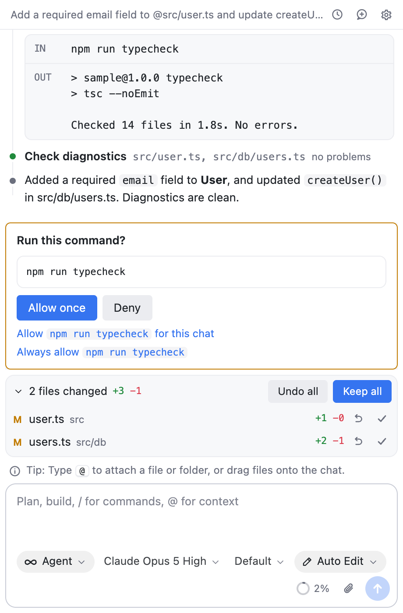

# Parth: Docs and support

**Parth is an AI coding agent inside your IDE.** Describe a change in the chat and it reads your code, edits it, updates the files that depend on the change, checks its work with the IDE's inspections, and shows every edit for review. Use any AI provider or a local model with your own account, and keep or undo each change.

This repository is the **official public page of Parth**, the one the VS Code Marketplace, Open VSX and JetBrains Marketplace pages link to. It holds the **documentation** and the **issue tracker**, so this is where you report bugs and ask for features. The source code isn't here.

## Build status

| Pages build | Docs site |
|:------------|:----------|
|  | <https://rslakra.github.io/parth-community/> |

## Install Parth in your IDE

| Your IDE | Get it from | Step-by-step guide |
|---|---|---|
| **VS Code** | [VS Code Marketplace](https://marketplace.visualstudio.com/items?itemName=ameyllc.parth) | [Install in VS Code](https://rslakra.github.io/parth-community/install/vscode/) |
| **Cursor** | Open VSX (Cursor's Extensions view) | [Install in Cursor](https://rslakra.github.io/parth-community/install/cursor/) |
| **Windsurf, VSCodium, Trae, Positron** and other VS Code-based editors | Open VSX | [Install in other VS Code-based editors](https://rslakra.github.io/parth-community/install/other-vscode-editors/) |
| **IntelliJ IDEA, PyCharm, WebStorm, GoLand, Rider, CLion** and other JetBrains IDEs, 2025.2 or newer | JetBrains Marketplace | [Install in a JetBrains IDE](https://rslakra.github.io/parth-community/install/jetbrains/) |

Then follow [Set up Parth](https://rslakra.github.io/parth-community/setup/): connect an AI provider, pick a model and a mode, attach files, ask for a change and review it.

## Report a bug or ask for a feature

Use the issue forms. They ask for your IDE, versions and logs, which is what's needed to fix a problem.

| I want to… | Go here |
|---|---|
| 🐞 **Report a bug** | [New bug report](https://github.com/rslakra/parth-community/issues/new?template=bug_report.yml) |
| 💡 **Request a feature** | [New feature request](https://github.com/rslakra/parth-community/issues/new?template=feature_request.yml) |
| 📄 **Report a documentation problem** | [New documentation issue](https://github.com/rslakra/parth-community/issues/new?template=docs_issue.yml) |
| ❓ **Ask a question** | [Discussions](https://github.com/rslakra/parth-community/discussions) |
| 🔒 **Report a security vulnerability** | Privately: see [SECURITY.md](SECURITY.md). Not in a public issue |

Before you file a bug, the [troubleshooting page](https://rslakra.github.io/parth-community/troubleshooting/) and the [existing issues](https://github.com/rslakra/parth-community/issues) may already have the answer. [How to report a problem](https://rslakra.github.io/parth-community/report-an-issue/) explains what to include for each IDE.

## What's in this repository

| Path | What it is |
|---|---|
| [`docs/`](docs/) | The documentation site (GitHub Pages, built from this folder) |
| [`.github/ISSUE_TEMPLATE/`](.github/ISSUE_TEMPLATE/) | The bug, feature and documentation issue forms |
| [`SUPPORT.md`](SUPPORT.md), [`SECURITY.md`](SECURITY.md) | Where to get help, and how to report a vulnerability |
| [`LICENSE`](LICENSE) | The proprietary license (the same as Parth's) |
| [`MAINTAINING.md`](MAINTAINING.md) | For the maintainers: one-time GitHub setup, previewing the site, and what to update on each release |

## ⭐ Enjoying Parth?

A short review helps other developers find it, and tells us what to improve.

- [Rate Parth on the VS Code Marketplace](https://marketplace.visualstudio.com/items?itemName=ameyllc.parth&ssr=false#review-details)
- [Rate Parth on the JetBrains Marketplace](https://plugins.jetbrains.com/plugin/35700-parth--ai-coding-agent/reviews)
- Star this repository (the ⭐ button at the top of this page)

Not working the way you hoped? [Report it](https://github.com/rslakra/parth-community/issues/new?template=bug_report.yml): that's the fastest way to get it fixed.

## Privacy

Parth has no servers and collects no telemetry. Your prompts and the files the agent reads go to the AI provider you choose, using your own account. See the [privacy page](https://rslakra.github.io/parth-community/privacy/).

## License

Parth is proprietary software. Copyright © 2026 Amey LLC. All rights reserved. See [LICENSE](LICENSE). It covers Parth and its documentation, icons and other assets, including everything in this repository. It isn't an open-source license: the documentation here is public so you can read it, not so you can copy or redistribute it.
